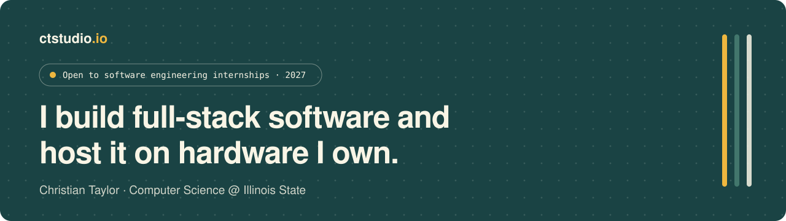
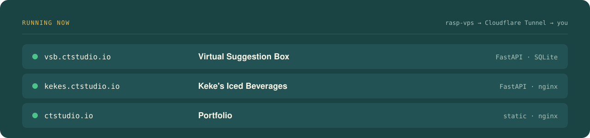

<picture>
  <source media="(prefers-color-scheme: light)" srcset="assets/banner-light.svg">
  
</picture>

<p align="center">
  <a href="https://ctstudio.io"></a>
  <a href="https://christian-taylor.com"></a>
  <a href="https://createdbyct.studio"></a>
</p>

I'm a Computer Science student at **Illinois State University**, looking for a **software engineering internship**.
I write Python, FastAPI and SQL on the back end and ship it to real users from my own Raspberry Pis.

When I'm not coding I work 12-hour shifts as an **ER tech at a Level I trauma center**, and I run **[CREATEDBYCT STUDIO](https://createdbyct.studio)**, my freelance motion, video and design studio. That's why my projects keep landing where healthcare, design and infrastructure overlap.

<br>

<picture>
  <source media="(prefers-color-scheme: light)" srcset="assets/running-light.svg">
  
</picture>

## Featured · Virtual Suggestion Box

**[vsb.ctstudio.io](https://vsb.ctstudio.io)** · Suggestion, nomination and survey forms for a group that needed one place to collect them. Real people use it every day.

- Multi-tenant owner dashboards with role-based access and **TOTP 2FA**
- Separate **live and dev instances**, restorable from backup
- FastAPI + SQLite + vanilla JS, with no frameworks, running under systemd on a Raspberry Pi

<details>
<summary><b>How it's hosted</b></summary>
<br>

```
browser ──► Cloudflare Tunnel ──► rasp-server (Pi 5, edge)
                                        │  LAN
                                        ▼
                                  rasp-vps (Pi 2, projects)
                                  ├─ vsb        FastAPI · SQLite · systemd
                                  ├─ kekes      FastAPI · nginx
                                  └─ ctstudio   nginx
```

No open ports on my router. Each project gets its own subdomain and its own service.
</details>

## More projects

| | Project | What it is | Stack |
|:-:|:--|:--|:--|
| 🟡 | **ED Flow** | Triage prediction for emergency departments, built from my time in the ER. **0.977** ESI-1 recall, **0.731** accuracy. | scikit-learn · FastAPI |
| 🟢 | **[Keke's Iced Beverages](https://kekes.ctstudio.io)** | Client site for a mobile lemonade trailer, with email signups and an admin analytics view. | FastAPI · nginx |
| 🟢 | **cs.visual** | A single-file algorithm visualizer you can open anywhere. | HTML · JavaScript |
| 🟢 | **Home lab monitoring** | Dashboard that watches my Pis, servers and the services running on them. | Python · Linux |
| 🟡 | **8-Queens, evolved** | A genetic algorithm that breeds its way to a valid board. Web view coming. | Python |

<sub>🟢 live &nbsp;·&nbsp; 🟡 in progress &nbsp;·&nbsp; ⚪ planned</sub>

## Stack I reach for

<p>
  
  
  
  
  
  
  
  
  
  
  
  
</p>

## Right now

- 🔍 Looking for a **Summer 2027 SWE internship**
- 🩺 Training ED Flow on more triage data
- 🧩 Building a web view for the 8-Queens solver

<br>

<p align="center">
  <a href="https://ctstudio.io"></a>
  <a href="https://christian-taylor.com"></a>
  <a href="mailto:christiantaylor94@gmail.com"></a>
</p>

<p align="center"><sub>© Christian Taylor</sub></p>
